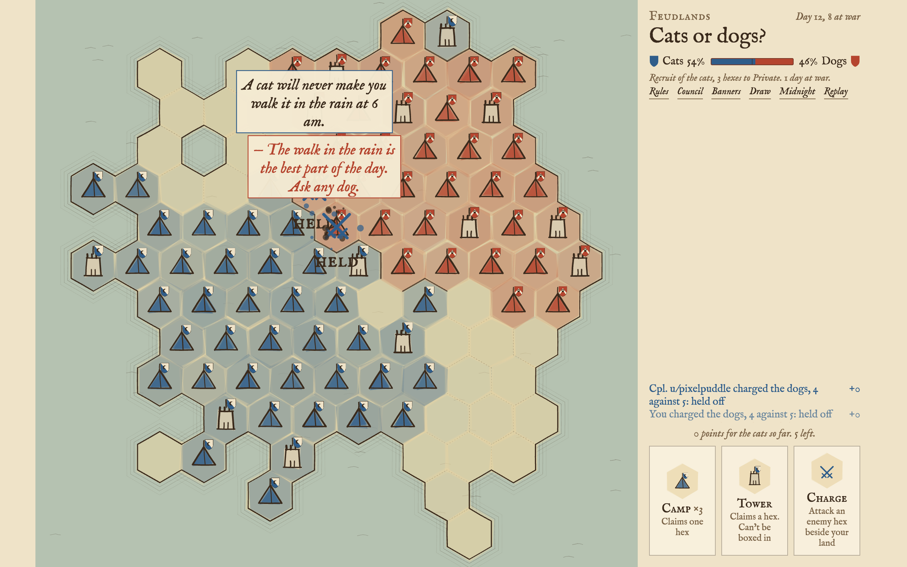

# Feudlands

A daily war over a hand-drawn island, played inside a Reddit post. Each day has one feud with two sides (cats or dogs, tabs or spaces). The whole subreddit fights for the same island, and the best arguments in the war council become the battle cries that win hexes.

**Play it:** [r/feudlands_dev](https://www.reddit.com/r/feudlands_dev/comments/1y4sw8n/feudlands_day_1_cats_or_dogs_pick_a_side_and_take/) · **Watch:** [trailer](https://youtu.be/jpMhNrNWPU4), [45-second Short](https://youtube.com/shorts/i0as6VDRdhA)

Built with [Devvit Web](https://developers.reddit.com/) for Reddit's Game of the Day hackathon.



## Try it
Open the demo post, press **Join the war**, and pick a side. The first few moves teach you: camps first, then surrounding, then charges, then the war council. **Skip training** opens everything at once. **Replay** plays the whole day again on the map.

## How it plays
- Pick a side for the day's feud. You're sent to one island of the day's archipelago: three to start, more as more people join.
- Hold an island and your side's fleet adds 1 to every charge on the islands beside it.
- Place camps on free hexes. Surround an enemy camp on every side and it turns to yours. Towers can't be boxed in.
- Charge an enemy hex beside your land. Attack is 1, plus your land around it, plus your battle cry. Defence is the piece, plus their land around it, plus 1 for holding it.
- Argue in the war council. Every 20 upvotes make an argument 1 stronger as a battle cry; the best rebuttal takes its score off.
- At 00:00 UTC the result is pinned under the post with the day replayed as a GIF, and tomorrow's feud, picked by the council, goes up as a new post.

## Daily loop
- A new feud goes up every day at 00:00 UTC, the one the council voted for. Players can suggest their own: a question, two sides and an opening argument for each. Nobody can vote for their own.
- The result is pinned under the post with the day replayed as a GIF.
- Your streak, days won, and "feud maker" go in your subreddit flair. Every seven days a post names the week's generals over a grid of the week's islands.
- When a feud comes round again, it's a rematch with last time's score.

## Layout
- `src/client`: the game (`game.html`, `game.js`) and the feed card (`splash.html`)
- `src/shared`: rules both sides agree on: the island, captures, charges, the crowd's moves, topics
- `src/server`: the Hono API, the move log in Redis, midnight, and the PNG and GIF painters
- `test`: server tests (`npm test`)
- `tools/local.ts`: the whole game against an in-memory server, no Reddit needed
- `../prototype/`: the first single-file prototype

## Run it
```sh
npm install
npm test             # server tests
npm run local        # http://localhost:5190/game.html, a local war in memory
npm run dev          # playtest on your own subreddit (needs `npm run login` first)
```
